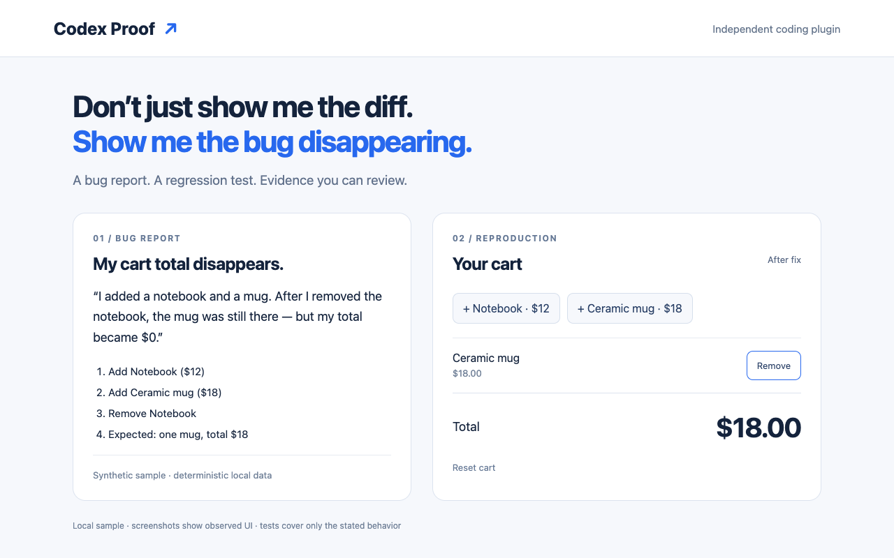

# Codex Proof

**Don’t just show me the diff. Show me the bug disappearing.**

An independent coding plugin for Codex. Give the agent a bug report; its `prove-bug` skill guides reproduction, a failing regression test, a minimal fix and reviewable before/after browser evidence. The bundled Python recorder preserves actual command output, exit codes, timestamps and SHA-256 hashes. The host agent writes code; the recorder does not automatically generate fixes.

No API keys, remote server, MCP integration or model API calls are required by the plugin. It uses the host's available coding and browser tools. The sample needs Node.js and Python 3; optional browser capture needs an existing Playwright installation and installed Chrome.

## Install locally

```sh
git clone https://github.com/ricky9408/codex-proof.git
cd codex-proof
codex plugin marketplace add .
codex plugin add codex-proof@codex-proof-local
codex plugin list --json
```

These opt-in commands install into your selected Codex configuration. The repo marketplace lives at `.agents/plugins/marketplace.json`, pointing to `./plugins/codex-proof`. The portable manifest is `plugins/codex-proof/plugin.json`; skills are discovered from its `skills/` directory. Desktop hosts can also select the local marketplace in the Plugins Directory. Host support varies by surface. See the [official packaging instructions](https://developers.openai.com/plugins/build/plugins).

Prompt: **“Use Codex Proof to reproduce this bug, add a regression test, fix it, and show before/after evidence: [report + expected result].”** The installed skill is named `codex-proof:prove-bug`.

## Try the reproducible sample

```sh
npm run test:before  # expected exit 1: buggy version resets remaining total to zero
npm test            # exit 0: same three assertions on the fixed version
npm run serve       # local-only: http://127.0.0.1:4173/sample/
```

Open `/sample/?variant=before` or `/sample/?variant=after`. Add Notebook ($12), add Ceramic mug ($18), remove Notebook. Before: mug remains, total $0.00. After: mug remains, total $18.00. Both code versions are preserved; no checkout reset required.




[Download the 22-second demo](codex-proof-demo.mp4) · [Bug report](BUG-REPORT.md) · [Regression test](sample/cart.test.mjs) · [Fix patch](evidence/fix.patch) · [Public evidence notes](evidence/README.md)

## What was verified

- Portable manifest validated against the Agent Plugins 1.0.0 schema.
- Codex CLI 0.151.0 discovered, installed and enabled the plugin in a temporary isolated Codex home. App-server `skills/list` loaded `codex-proof:prove-bug` with no errors. Temporary config was removed; no credentials copied or model calls made.
- The plugin's bundled recorder was directly invoked for before/after regression tests and the original evidence report. Before: 1 passed, 2 failed, exit 1. After: 3 passed, exit 0. Same test assertions.
- Installed Google Chrome 154, automated with Playwright in a temporary isolated profile, observed the stated $0 → $18 behavior at 1280×800. Fixed mobile flow passed at 390×844 with no horizontal overflow. Desktop console errors: none.
- Recorder checks verify actual output/exit preservation and prevent timeout/launch error from qualifying as a reproduced regression.

**Not verified:** model-backed agent invocation of the installed skill, general correctness, security, payments, backend integration, performance, or cross-browser compatibility. This is synthetic local data, not a customer incident. Evidence is reviewable output, not signed attestation.

The demo is edited from real Chrome recordings, genuine browser screenshots and actual log excerpts. Chrome's screencast retained stale final frames, so outcomes are shown with observed PNG captures. It is not a continuous recording of an installed plugin session. Public logs redact machine paths only; assertion results are unchanged.

## Optional capture

Start `npm run serve`, then use an already installed Playwright package:

```sh
PLAYWRIGHT_MODULE=/absolute/path/to/playwright/index.mjs node scripts/browser-proof.mjs
PLAYWRIGHT_MODULE=/absolute/path/to/playwright/index.mjs node scripts/demo-slides.mjs
python3 scripts/build-video.py  # requires existing ffmpeg/ffprobe
python3 scripts/check-recorder.py
```

Capture scripts use installed Chrome and synthetic localhost data. The evidence recorder is `plugins/codex-proof/skills/prove-bug/scripts/proof.py`; read its skill instructions before using it on another repo. Do not publish private source, production data, cookies or credentials.

## Independence and license

Independent project; not affiliated with, sponsored by or endorsed by OpenAI. Codex names the compatible host. License selection is pending; no license grant is included. Nothing has been posted to social media or submitted to a contest by this project.
